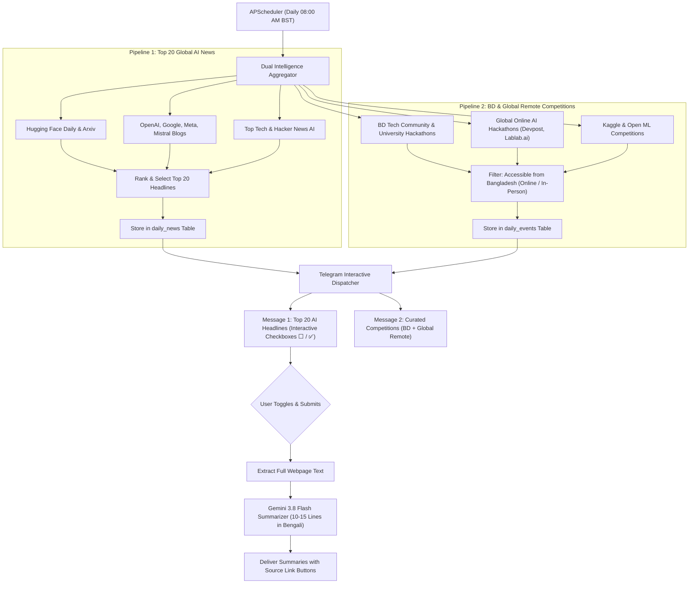

# Technical Specification: Daily AI News & Global/BD Hackathon Intelligence Agent

**Document ID:** `SPEC-2026-AI-NEWS-001`  
**Status:** UPDATED (Incorporating Global Virtual & Bangladesh Competitions)  
**Target Delivery Schedule:** Daily at 08:00 AM BST (Asia/Dhaka)  

---

## 1. Executive Summary & Objectives

The goal of this system is to transform the user's 24/7 personal Telegram bot (`@Sharif_1st_Agent_bot`) into an autonomous, daily AI Intelligence & Competition Digest assistant. Every morning at **8:00 AM**, the agent will autonomously:
1. Scan the global web and research platforms for the past 24 hours of top artificial intelligence, open-source models, and developer breakthroughs.
2. Select and rank the **Top 20 most critical headlines**.
3. Scan for both:
   * **Bangladesh Local Competitions:** University tech fests, national AI hackathons, and olympiads.
   * **Global Virtual/Remote Competitions:** International AI hackathons (Devpost, Lablab.ai, Kaggle, Hugging Face, etc.) that can be joined remotely from Bangladesh.
4. Present the items via an interactive **Multi-Select Checkbox UI** on Telegram.
5. Generate rich, **10-15 line structured Bengali summaries** for all news items selected by the user upon submission, complete with direct clickable source links.

---

## 2. Architecture & Data Flow



---

## 3. Database Schema Specification

```yaml
database:
  file: "memory.db"
  tables:
    daily_news:
      columns:
        id: "INTEGER PRIMARY KEY AUTOINCREMENT"
        publish_date: "TEXT NOT NULL" # YYYY-MM-DD
        category: "TEXT NOT NULL"     # 'GLOBAL_AI'
        title: "TEXT NOT NULL"
        source_name: "TEXT NOT NULL"
        url: "TEXT UNIQUE NOT NULL"
        cached_summary: "TEXT"
        created_at: "TIMESTAMP DEFAULT CURRENT_TIMESTAMP"
      indexes:
        - "CREATE INDEX idx_daily_news_date ON daily_news(publish_date);"

    daily_events:
      columns:
        id: "INTEGER PRIMARY KEY AUTOINCREMENT"
        event_name: "TEXT NOT NULL"
        organizer: "TEXT NOT NULL"      # e.g., 'Devpost', 'Lablab.ai', 'BUET'
        location_type: "TEXT NOT NULL"  # 'Online (Global)' or 'In-Person (Bangladesh)'
        prize_pool: "TEXT"              # e.g., '$50,000' or 'Certificates & Swag'
        deadline: "TEXT"                # Registration deadline
        url: "TEXT UNIQUE NOT NULL"
        status: "TEXT DEFAULT 'ACTIVE'"
        created_at: "TIMESTAMP DEFAULT CURRENT_TIMESTAMP"

    user_selection_state:
      columns:
        user_id: "INTEGER PRIMARY KEY"
        active_message_id: "INTEGER NOT NULL"
        selected_news_ids: "TEXT NOT NULL" # "1,3,7,12"
        updated_at: "TIMESTAMP DEFAULT CURRENT_TIMESTAMP"
```

---

## 4. UI / UX Design: Telegram Interactive System

### 4.1 Message 1: Top 20 Global AI Headlines
* **Header:**
  > 🌅 **শুভ সকাল! আজকের শীর্ষ ২০টি এআই ও ওপেন-সোর্স আপডেট**  
  > 📅 *তারিখ: ১৫ অক্টোবর ২০২৬*  
  > যে যে নিউজের বিস্তারিত পড়তে চান, সেগুলোতে টিক দিন এবং নিচে **"সাবমিট"** বাটনে চাপ দিন:
* **Interactive Checkbox Buttons:**
  * `[ ⬜ ১. Meta Llama 4 আর্কিটেকচার প্রিভিউ ]`
  * `[ ⬜ ২. Mistral নতুন ভিশন মডেল ওপেন সোর্স করেছে ]`
  * ...
  * `[ ⬜ ২০. Hugging Face নতুন ডেটাসেট ফ্রেমওয়ার্ক উন্মোচন ]`
  * `[ 🚀 নির্বাচিত নিউজের সামারি দাও (০টি সিলেক্টেড) ]`

### 4.2 Message 2: BD & Global Remote AI Hackathons
* **Header:**
  > 🏆 **চলমান এআই হ্যাকাথন ও প্রতিযোগিতা (বাংলাদেশ ও গ্লোবাল রিমোট)**  
  > *বাংলাদেশ থেকে যেগুলোতে আপনি ঘরে বসেই অথবা সরাসরি অংশ নিতে পারবেন:*
* **Format:**
  * 🌐 **১. Devpost Generative AI Challenge**  
    * 🏢 **আয়োজক:** AWS & Devpost  
    * 🌍 **টাইপ:** অনলাইন (সবার জন্য উন্মুক্ত)  
    * 💰 **পুরস্কার:** $৪০,০০০  
    * ⏰ **ডেডলাইন:** ২০ অক্টোবর ২০২৬  
    * 🔗 [রেজিস্ট্রেশন লিংক](https://...)
  * 🇧🇩 **২. ন্যাশনাল এআই হ্যাকাথন ২০২৬**  
    * 🏢 **আয়োজক:** ঢাকা বিশ্ববিদ্যালয়  
    * 🌍 **টাইপ:** হাইব্রিড (অনলাইন + অন-সাইট)  
    * 🔗 [রেজিস্ট্রেশন লিংক](https://...)

---

## 5. Summarization Engine (10-15 Lines Structured Bengali)

When selected articles are submitted:
1. **Readable Text Extraction:** High-fidelity web extraction of article content.
2. **Gemini 3.8 Flash Prompt Design:**
   * **Language:** Natural, crystal-clear, professional Bengali (বোধগম্য ও সাবলীল বাংলা).
   * **Length:** Strictly 10 to 15 lines.
   * **Required Sections:**
     - 📌 **মূল ঘটনা / কী রিলিজ হয়েছে:** (৩-৪ লাইন)
     - ⚙️ **প্রযুক্তিগত বৈশিষ্ট্য ও স্পেসিফিকেশন:** (৩-৪ লাইন)
     - 💡 **কেন এটি গুরুত্বপূর্ণ ও কাদের জন্য সহায়ক:** (৩-৪ লাইন)
     - 🚀 **ভবিষ্যত প্রভাব ও ব্যবহারিক সুযোগ:** (২-৩ লাইন)
3. **Action Button:** Attached `[ 🔗 মূল ওয়েবসাইট / পেপার ভিজিট করুন ]` button.

---

## 6. Execution & Scheduling

* **Engine:** `APScheduler` (CronTrigger)
* **Timezone:** `Asia/Dhaka` (UTC+6)
* **Hour / Minute:** `08:00 AM` daily
* **Fault Tolerance:** Server-restart safe; uses SQLite to prevent re-sending duplicate events.

---

## 7. Implementation Roadmap

1. **Step 1:** Create `news_collector.py` (Dual scraper: Global AI top 20 + BD & Global Remote Hackathons).
2. **Step 2:** Create `news_summarizer.py` (Text scraper + Gemini 10-15 lines Bengali summarizer).
3. **Step 3:** Implement SQLite migration in `memory.db` (`daily_news`, `daily_events`, `user_selection_state`).
4. **Step 4:** Implement Interactive Multi-select Checkbox Telegram handlers in `bot.py`.
5. **Step 5:** Configure `APScheduler` daily 8:00 AM Asia/Dhaka cron job.
6. **Step 6:** Push to GitHub (`git push`) for automatic 24/7 Render cloud deployment.
